# HTML Slide Template Pack — 3 Styles × 10 Slide Types

Presentation templates that live in a single HTML file. Open in a browser, present anywhere, export to PDF when you need a file. No PowerPoint, no build tools, no subscriptions.

**English edition (primary) + Chinese edition included** — every style comes in both languages, each a complete 10-slide deck.

## What's inside

| Style | Look | Best for |
|---|---|---|
| **Minimal Business** | Warm paper white, hairline rules, one deep-teal accent | Board updates, annual reviews, consulting decks |
| **Editorial Magazine** | Cream stock, full serif, brick-red accents, real magazine grammar (masthead, folios, drop caps, pull-quotes) | Brand stories, editorial pitches, cultural & lifestyle topics |
| **Dark Tech** | Near-black console aesthetic, mint glow, mono labels, hand-drawn SVG charts | Engineering talks, product launches, data reviews |

Every deck contains the same 10 slide types: **Cover · Agenda · Section divider · Single-column content · Two-column content · Data/chart · Table · Quote · Comparison · Closing** — duplicate or delete sections to reshape the deck; a full guide is in `docs/USER-GUIDE.md`.

## Previews

### Minimal Business
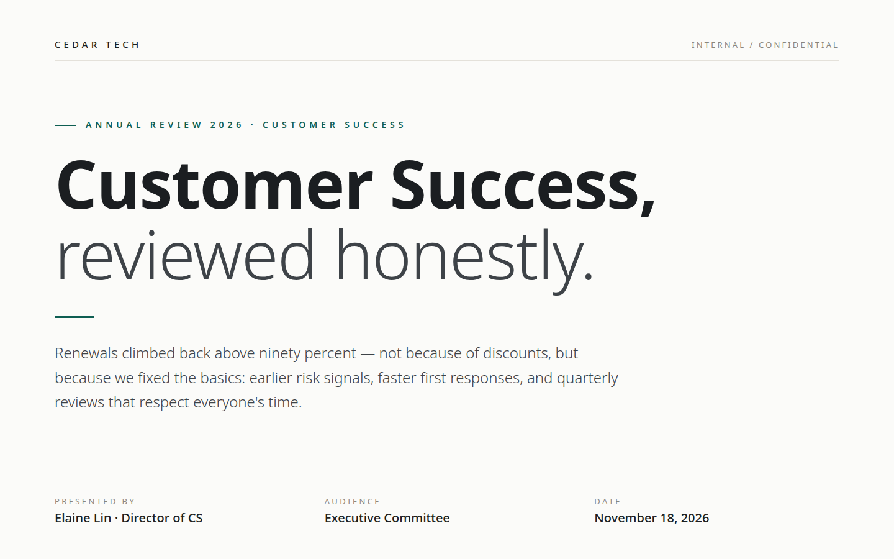
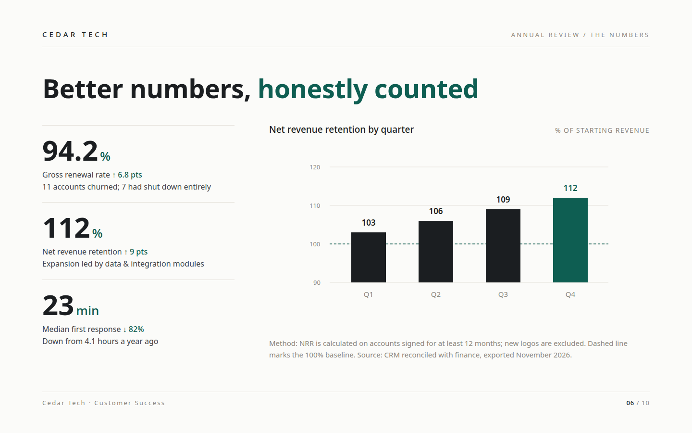
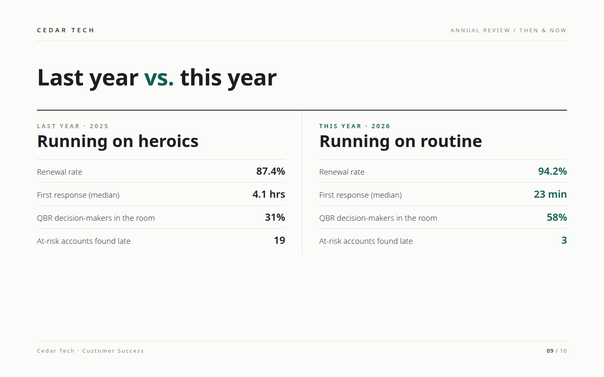
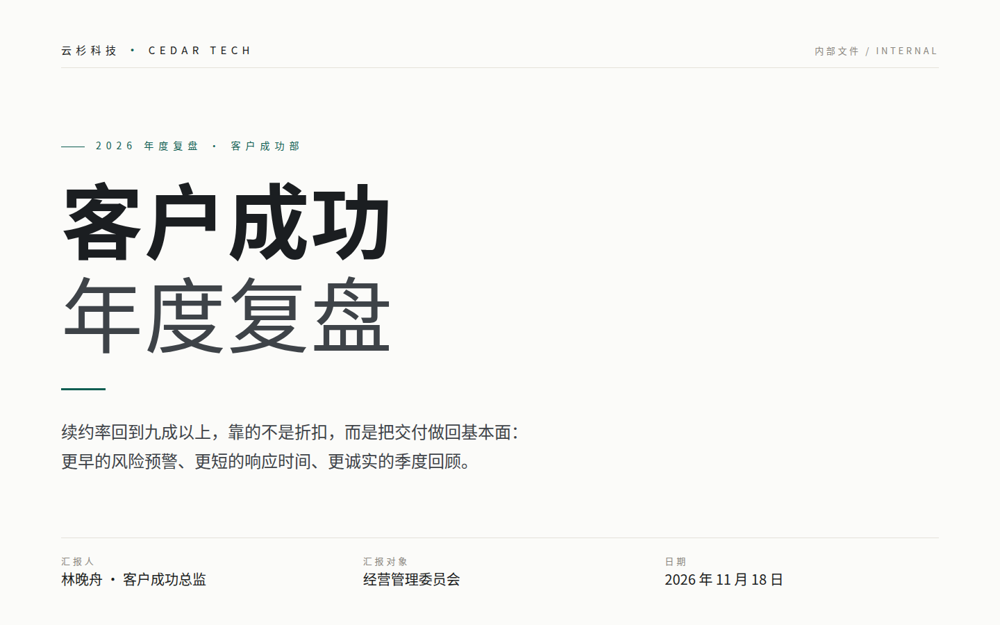

### Editorial Magazine
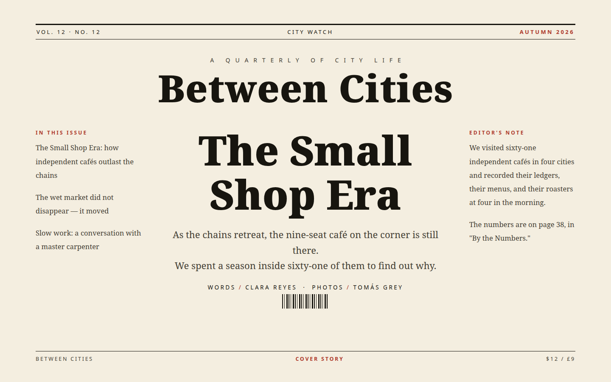
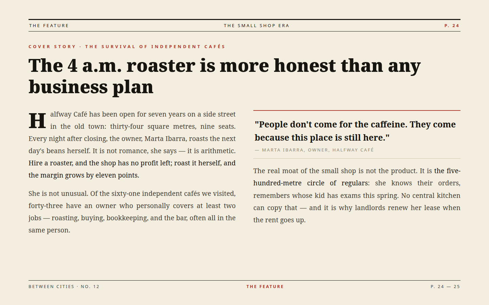
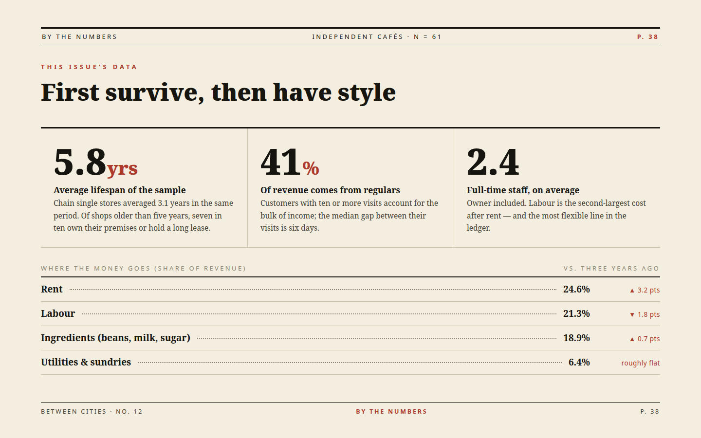

### Dark Tech
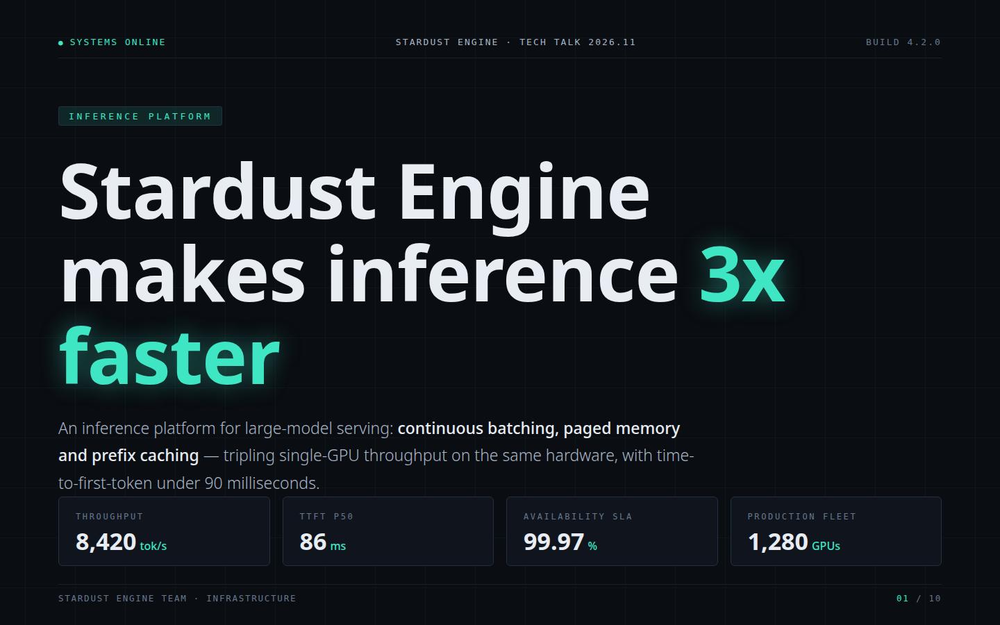
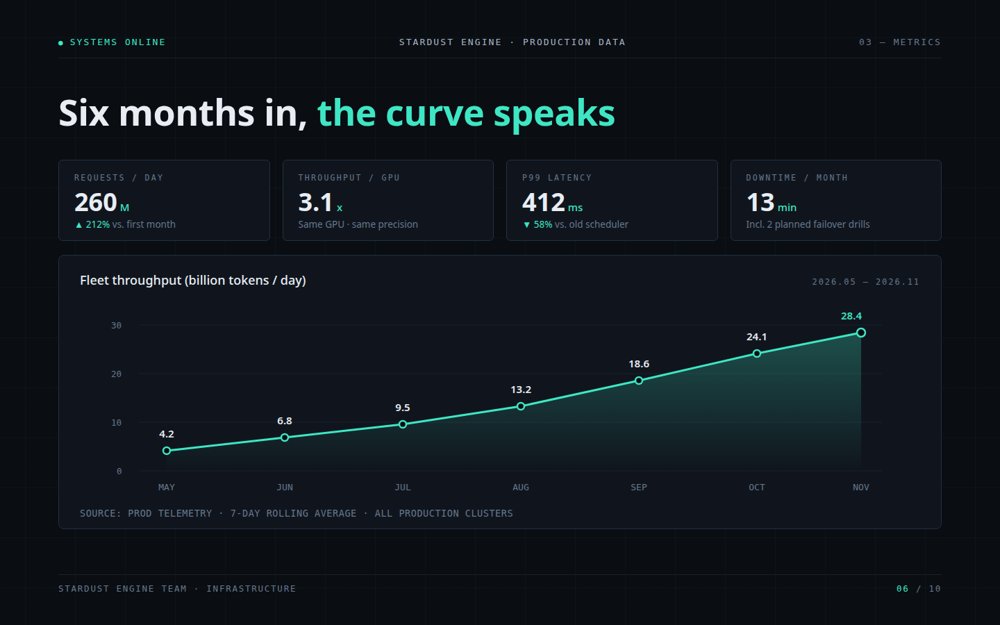
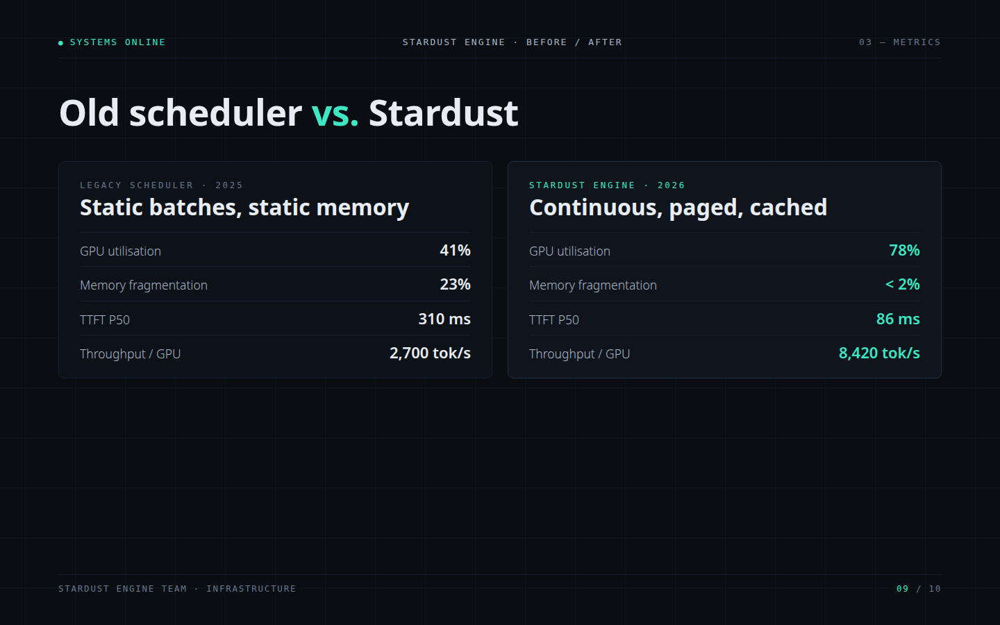
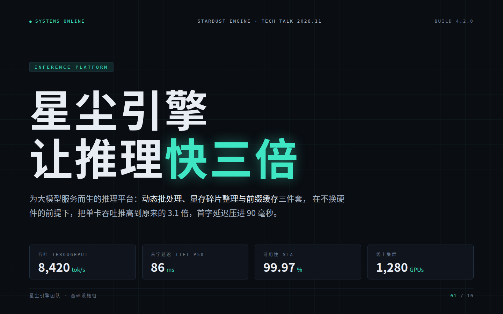

## Quick start

1. Unzip, pick a style and a language: `templates/<style>/en/` (or `zh/`).
2. Double-click `index.html`. Present with arrow keys or Space; `Esc` shows all slides.
3. Edit the text directly in `index.html`; recolour the whole deck from the CSS variables at the top of the `<style>` block.
4. For a PDF: open `index.html?print-pdf`, print to PDF with margins off and background graphics on.

Full instructions — editing, colours, images, PDF export, troubleshooting — are in **[docs/USER-GUIDE.md](docs/USER-GUIDE.md)**.

## Details

- Canvas: 1440 × 900 (16:9), auto-scaling to any screen.
- Works fully offline; the reveal.js engine (MIT) is bundled in each folder's `vendor/`.
- Fonts: system open fonts only (Noto Sans / Noto Serif / Noto CJK families with standard fallbacks) — nothing to install or license.
- Charts are hand-written inline SVG — no chart libraries, no trackers, no external requests.
- All sample content is fictional, written to show exactly where your content goes.

## Licence

Use the templates for your own presentations, including commercial ones. Do not resell or redistribute the template files themselves. Full terms in `docs/USER-GUIDE.md`, section 6.
